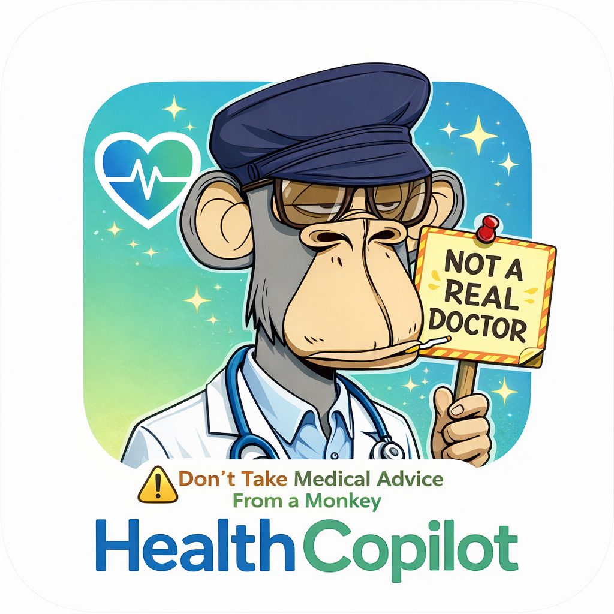

# Lulo's NOT a Health Copilot

<p align="center">
  
</p>

<p align="center"><em>Don't take medical advice from a monkey.</em></p>

A fully local medical image analysis app powered by [MedGemma 1.5](https://huggingface.co/google/medgemma-4b-it) and [Ollama](https://ollama.com). Upload X-rays, CT scans, MRI slices, or clinical photos — optionally pulling records directly from Epic / MyChart or a PACS server — and get AI-powered analysis through a conversational chat interface. Everything runs on your machine. No data leaves your computer.

---

> **WARNING — NOT A MEDICAL DEVICE**
>
> This software is **NOT** a medical device, is **NOT** FDA-cleared or approved, and is **NOT** intended to diagnose, treat, cure, or prevent any disease or medical condition. It has not been validated for clinical use and must **NEVER** be used as a substitute for professional medical judgment.
>
> **Do not** make any medical decisions based on the output of this software. The AI model may produce inaccurate, incomplete, misleading, or entirely fabricated results. All outputs are for **research and educational purposes only**.
>
> **Always consult a qualified healthcare professional** for any medical questions, concerns, or decisions. If you are experiencing a medical emergency, call your local emergency number immediately.
>
> The developers, contributors, and maintainers of this project accept **no liability** whatsoever for any harm, injury, loss, or damage — direct or indirect — arising from the use or misuse of this software or its outputs. By using this software, you acknowledge and agree that you do so **entirely at your own risk**.

---

## What It Does

### Imaging
- **DICOM support** — Load `.dcm` files or entire DICOM folders. 3-channel windowing (bone/lung, soft tissue, brain) converts raw Hounsfield units into optimized RGB images for the model
- **Multi-slice series** — Browse slices with a scrubber, thumbnail strip, and ← → / S keyboard shortcuts. Auto-pick representative slices or include them manually with a single pill button
- **Standard images** — X-rays, photos, and any JPEG/PNG work just as well

### Clinical Notes
- Paste or upload after-visit summaries, lab results, or clinical notes (PDF or plain text)
- Toggle notes in/out of the chat context with the include pill — no separate "load" step

### Sources (Epic + PACS)
- **Epic / MyChart** — Sign in with SMART on FHIR (OAuth2 + PKCE). Imports DocumentReferences, DiagnosticReports, and Observations as notes context. Token stored encrypted on-device via Electron `safeStorage`; read-only scopes only
- **PACS / DICOMweb** — Connect to any QIDO-RS/WADO-RS server (hospital PACS, Orthanc, cloud archive). Search by patient ID, name, or accession; open studies directly into the viewer. Auth supports None, HTTP Basic, and Bearer token

### Chat
- Streaming responses from MedGemma rendered as structured sections (`##` headings → teal labels, bold, lists)
- Context chips above the composer show what's included (slices ×, notes ×) — click × to exclude
- Suggested prompts on first open; "Analyze N slices" updates with your selection

### General
- **Cases sidebar** — Pinned / This week / Earlier groups with DICOM thumbnail or CT/MR/TXT badge, right-click menu for pin/rename/delete
- **Bilingual** — Full EN / ES toggle covering all UI copy and AI prompts
- **Completely local** — No cloud APIs, no telemetry, no internet required after first model download

---

## Installation (For Users)

Download the latest release for your platform from the [Releases page](https://github.com/KeNFT1/medgemma-viewer/releases):

| Platform | File |
|---|---|
| macOS (M1/M2/M3/M4) | `Lulos-Health-Copilot-mac-arm64.dmg` |
| macOS (Intel) | `Lulos-Health-Copilot-mac-x64.dmg` |
| Windows | `Lulos-Health-Copilot-Setup.exe` |

**First launch:** the app will download the MedGemma model (~5 GB). Keep the app open and wait for the status pill to turn green.

> **macOS Gatekeeper:** If you see "App is damaged" or "Unidentified Developer", right-click the app → Open, or go to System Settings → Privacy & Security → Open Anyway.

---

## Installation (For Developers)

### Prerequisites

- [Ollama](https://ollama.com/download) installed and in your PATH
- Node.js 18+
- ~5 GB disk space for the MedGemma model
- 8 GB RAM minimum (16 GB recommended for DICOM series)

### Option 1: Browser (quickest)

```bash
git clone https://github.com/KeNFT1/medgemma-viewer.git
cd medgemma-viewer
chmod +x launch.sh
./launch.sh
```

The launcher starts Ollama with CORS enabled, pulls the model if needed, and opens `http://localhost:8090`.

> **Note:** Epic and PACS live networking require the Electron app (they use `net` from the main process to avoid CORS). The browser mode shows the UI but those buttons are gracefully disabled.

### Option 2: Electron Desktop App

```bash
cd electron-app
npm install
npm start         # development — hot-reloads root index.html
```

To build a distributable:

```bash
npm run build:mac:arm64   # macOS Apple Silicon (.dmg)
npm run build:mac:x64     # macOS Intel (.dmg)
npm run build:win         # Windows (.exe + portable)
```

Built output lands in `electron-app/dist/`.

### Manual Model Setup

```bash
ollama pull hf.co/unsloth/medgemma-1.5-4b-it-GGUF:Q8_0
ollama cp hf.co/unsloth/medgemma-1.5-4b-it-GGUF:Q8_0 medgemma-vision
```

### Epic Integration Setup (optional)

Epic requires a registered app client ID. Without it the Sources modal UI works but sign-in will fail.

1. Register a **patient-facing public client** at [open.epic.com](https://open.epic.com)
2. Add `http://127.0.0.1` as a redirect URI (loopback — any port)
3. Set `EPIC_CLIENT_ID` and optionally `EPIC_FHIR_BASE` before launching:

```bash
EPIC_CLIENT_ID=your-client-id npm start
```

Scopes requested: `patient/DocumentReference.read patient/DiagnosticReport.read patient/Observation.read patient/ImagingStudy.read openid fhirUser offline_access`

### PACS / DICOMweb Setup (optional)

Point the PACS tab at any DICOMweb server (QIDO-RS + WADO-RS). For DIMSE-only PACS, run [Orthanc](https://www.orthanc-server.com/) locally as a bridge:

```bash
docker run -p 8042:8042 -p 4242:4242 orthancteam/orthanc
# then point the app at http://127.0.0.1:8042
```

---

## Architecture

The app is a **single HTML file** (`index.html`) with inline CSS and JavaScript plus two CDN dependencies:

- **[dicomParser.js](https://github.com/cornerstonejs/dicomParser)** — Parses `.dcm` files in the browser
- **[PDF.js](https://mozilla.github.io/pdf.js/)** — Extracts text from PDF clinical notes

The backend is Ollama running locally, serving MedGemma 1.5 4B via `POST /api/chat` with `stream: true`.

### Electron layer (`electron-app/`)

| File | Role |
|---|---|
| `main.js` | Ollama lifecycle (find, start, pull model); Epic SMART + PACS DICOMweb IPC handlers |
| `preload.js` | Exposes `window.epic.*` and `window.pacs.*` to the renderer via `contextBridge` |
| `epicAuth.js` | PKCE helpers, loopback OAuth server, token exchange, `safeStorage` encryption |
| `package.json` | electron-builder config; copies root `index.html` into the bundle at build time |

### Data flow

```
index.html (renderer)
  │
  ├─ DICOM windowing → base64 PNG → Ollama /api/chat (stream)
  ├─ PDF.js text extract → notes context
  │
  ├─ window.epic.authStart() ──IPC──► main.js epicAuth.startEpicAuth()
  │                                       └─ loopback HTTP → Epic OAuth
  │                                       └─ FHIR R4 resources via net.fetch
  │
  └─ window.pacs.search() ────IPC──► main.js net.fetch → QIDO-RS
     window.pacs.fetchInstance() ──► main.js net.fetch → WADO-RS → dicomParser
```

### State

- **IndexedDB** — image blobs + DICOM metadata per thread
- **localStorage** — thread list, connections metadata (no secrets)
- **Electron safeStorage** — Epic refresh token (encrypted at rest)

---

## Project Structure

```
medgemma-viewer/
├── index.html              # Single-file webapp (runs in browser or Electron)
├── logo.png                # App icon
├── launch.sh               # Browser launcher (Ollama + web server)
├── model/
│   └── Modelfile           # Ollama model reference config
└── electron-app/
    ├── main.js             # Main process: Ollama mgmt + Epic/PACS IPC
    ├── preload.js          # contextBridge: window.epic.* + window.pacs.*
    ├── epicAuth.js         # SMART on FHIR PKCE auth helper
    └── package.json        # Build config (electron-builder)
```

---

## How It Was Built

Built through a conversational coding session with **Claude** (Anthropic) using **Claude Code**. The full redesign, Epic/PACS integration, and all architectural decisions were made iteratively through natural language prompts with no manual code editing.

---

<details>
<summary><strong>Leer en Español</strong></summary>

# Lulo's NOT a Health Copilot

<p align="center">
  
</p>

<p align="center"><em>No aceptes consejos médicos de un mono.</em></p>

Una aplicación de análisis de imágenes médicas completamente local, impulsada por [MedGemma 1.5](https://huggingface.co/google/medgemma-4b-it) y [Ollama](https://ollama.com). Sube radiografías, tomografías, resonancias magnéticas o fotos clínicas — opcionalmente importando registros desde Epic / MyChart o un servidor PACS — y obtén análisis con IA a través de un chat conversacional. Todo se ejecuta en tu máquina. Ningún dato sale de tu computadora.

---

> **ADVERTENCIA — NO ES UN DISPOSITIVO MÉDICO**
>
> Este software **NO** es un dispositivo médico, **NO** cuenta con aprobación de la FDA, y **NO** está destinado a diagnosticar, tratar, curar o prevenir ninguna enfermedad. No ha sido validado para uso clínico y **NUNCA** debe usarse como sustituto del criterio médico profesional.
>
> **No tomes** ninguna decisión médica basada en los resultados de este software. Todos los resultados son únicamente para **fines de investigación y educación**. **Siempre consulta a un profesional de salud calificado.**

---

## Qué Hace

### Imágenes
- **Soporte DICOM** — Carga archivos `.dcm` o carpetas DICOM completas con windowing de 3 canales
- **Series multi-corte** — Navega los cortes con un control deslizante, tira de miniaturas y atajos de teclado ← → / S. Selección automática o manual con el botón de inclusión
- **Imágenes estándar** — Radiografías, fotos y cualquier JPEG/PNG funcionan igual

### Notas Clínicas
- Pega o sube resúmenes de consulta, resultados de laboratorio o notas clínicas (PDF o texto plano)
- Alterna notas dentro/fuera del contexto del chat con el botón de inclusión

### Fuentes (Epic + PACS)
- **Epic / MyChart** — Inicia sesión con SMART on FHIR (OAuth2 + PKCE). Importa DocumentReferences, DiagnosticReports y Observaciones como contexto de notas. Token cifrado en el dispositivo; solo permisos de lectura
- **PACS / DICOMweb** — Conéctate a cualquier servidor QIDO-RS/WADO-RS. Busca por ID de paciente, nombre o número de acceso. Auth: ninguna, HTTP Basic o Bearer token

### Chat
- Respuestas en streaming renderizadas como secciones estructuradas
- Chips de contexto sobre el compositor muestran lo incluido (cortes ×, notas ×)
- Prompts sugeridos al abrir; "Analizar N cortes" se actualiza con tu selección

### General
- **Barra lateral de casos** — Grupos Anclados / Esta semana / Anteriores con miniaturas DICOM o badge CT/MR/TXT
- **Bilingüe** — Toggle completo EN / ES
- **Completamente local** — Sin APIs en la nube, sin telemetría

---

## Instalación (Usuarios)

Descarga la última versión desde la [página de Releases](https://github.com/KeNFT1/medgemma-viewer/releases):

| Plataforma | Archivo |
|---|---|
| macOS (M1/M2/M3/M4) | `Lulos-Health-Copilot-mac-arm64.dmg` |
| macOS (Intel) | `Lulos-Health-Copilot-mac-x64.dmg` |
| Windows | `Lulos-Health-Copilot-Setup.exe` |

**Primer inicio:** la app descargará el modelo MedGemma (~5 GB). Mantén la app abierta y espera a que la pastilla de estado se ponga verde.

---

## Instalación (Desarrolladores)

### Opción 1: Navegador (más rápido)

```bash
git clone https://github.com/KeNFT1/medgemma-viewer.git
cd medgemma-viewer
chmod +x launch.sh
./launch.sh
```

### Opción 2: App de Escritorio Electron

```bash
cd electron-app
npm install
npm start
```

Para compilar:

```bash
npm run build:mac:arm64   # macOS Apple Silicon
npm run build:mac:x64     # macOS Intel
npm run build:win         # Windows
```

### Configuración de Epic (opcional)

Registra un cliente público en [open.epic.com](https://open.epic.com) y lanza con:

```bash
EPIC_CLIENT_ID=tu-client-id npm start
```

### Configuración de PACS (opcional)

Para PACS solo DIMSE, usa Orthanc como puente DICOMweb:

```bash
docker run -p 8042:8042 -p 4242:4242 orthancteam/orthanc
# apunta la app a http://127.0.0.1:8042
```

---

## Cómo Fue Construido

Construido a través de una sesión de codificación conversacional con **Claude** (Anthropic) usando **Claude Code**. Todo el rediseño, la integración Epic/PACS y las decisiones arquitectónicas se tomaron de forma iterativa a través de prompts de lenguaje natural.

</details>

---

<div align="center">
  
  <br/>
  <sub>Built by <a href="https://github.com/KeNFT1">KeNFT1</a> 🦍 BAYC #2253</sub>
</div>
